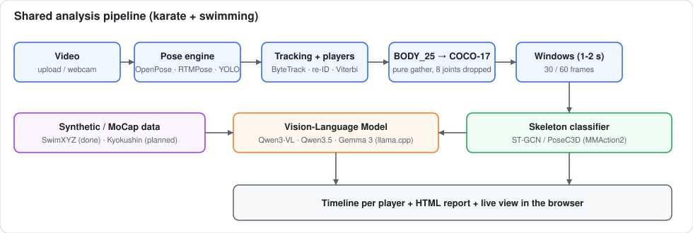
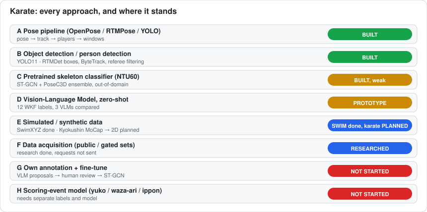
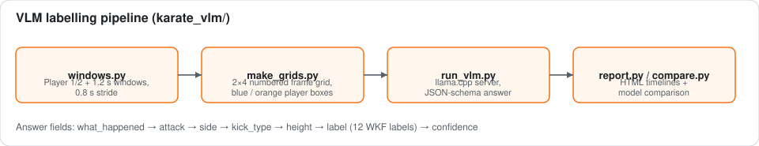
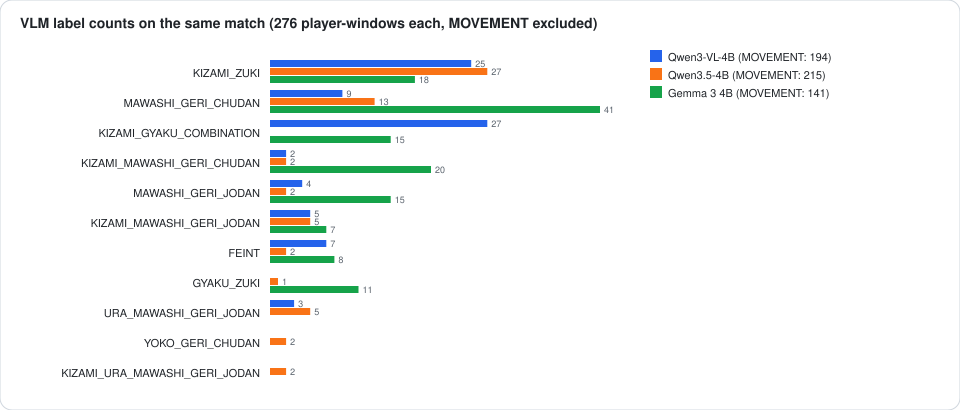
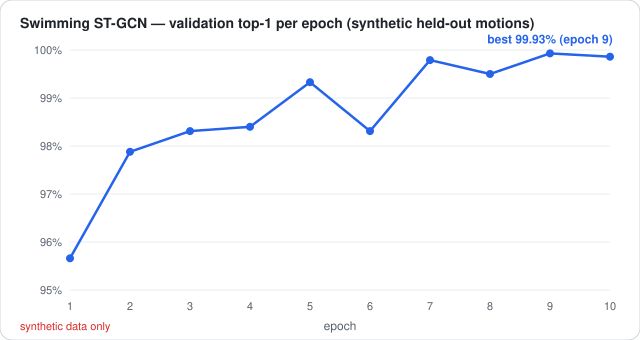
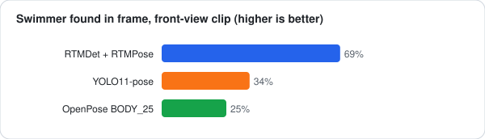
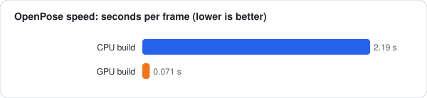
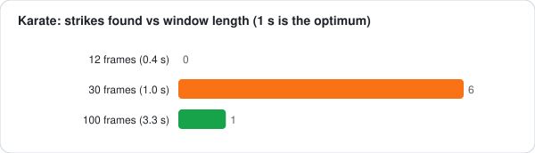

# Karate + Swimming Action Analysis

Skeleton-based sports analysis built around one shared pipeline, with **two sports**
(karate kumite, swimming) and **several approaches** to the labelling problem
(pretrained skeleton models, a local VLM, synthetic data).

> Arabic status report (what is finished, exactly): [`docs/STATUS_AR.md`](docs/STATUS_AR.md) ·
> every karate approach in detail: [`docs/KARATE_APPROACHES.md`](docs/KARATE_APPROACHES.md) ·
> dataset research: [`docs/DATASET_RESEARCH.md`](docs/DATASET_RESEARCH.md)



```
video ──► pose engine ──► tracking / player identity ──► BODY_25 → COCO-17
          (OpenPose GPU,    (ByteTrack + re-ID + Viterbi)      │
           RTMPose, YOLO11)                                    ▼
                                         ┌─────────────────────┴────────────────────┐
                                         ▼                                          ▼
                              skeleton classifier                        Vision-Language Model
                              (ST-GCN / PoseC3D, MMAction2)              (Qwen3-VL / Qwen3.5 / Gemma3, llama.cpp)
                                         │                                          │
                                         └────────────► timeline / report ◄─────────┘
```

## Honest status in one table

| Part | Status | Evidence |
|---|---|---|
| End-to-end web app (upload → pose → tracking → classifier → browser, plus live webcam) | **Done, verified** | `app/`, `docs/PROJECT_STATE.md` (measured timings) |
| GPU OpenPose, 30× faster than CPU (0.071 s/frame) | **Done** | `docs/PROJECT_STATE.md` §15 |
| Kumite player tracking (ByteTrack, re-ID, two-player follow, Viterbi swap fix) | **Done** | `app/backend/app/services/{bytetrack,players_identity,player_follow}.py` |
| Alternative pose engines (RTMPose, YOLO11-pose) | **Done, compared** | `app/backend/app/services/pose_engine_service.py` |
| **Swimming stroke model** (ST-GCN, 4 strokes) trained on synthetic SwimXYZ | **Trained** — 99.93 % top-1 on *held-out synthetic motions* | `swimming/`, `models/swimming/` |
| Swimming accuracy on **real** pool video | **Not measured** (no labelled real video) | — |
| Karate VLM technique labelling (12 WKF labels), 3 VLMs compared | **Prototype run on 1 match, no ground truth** | `karate_vlm/` |
| **Karate trained classifier** | **Does not exist yet.** Only out-of-domain NTU RGB+D 60 models are wired in | `docs/PROJECT_STATE.md` §2–3 |
| Karate labelled dataset | **Blocked** — no public downloadable karate video dataset | `docs/DATASET_RESEARCH.md` |

Rule kept throughout the project: the system is never described as recognising karate
until a model is trained **and** evaluated on held-out karate performers.

## Repository layout

```
app/              web app: FastAPI backend, React/Vite frontend, setup scripts
  backend/app/services/   pose engines, tracking, player identity, converters, sliding-window timeline,
                          ensemble, swimming service, live (webcam) sessions
  frontend/src/           upload, pipeline status, timeline, live view, karate + swimming pages
  scripts/                PowerShell installers (GPU OpenPose, CUDA venv, model download)
swimming/         SwimXYZ → PoseDataset conversion, leakage-aware split, ST-GCN config, training log, evaluation
karate_vlm/       VLM pipeline: windows → 2×4 frame grids → llama.cpp server → JSON-constrained labels → HTML reports
models/swimming/  the trained swimming ST-GCN checkpoint (12.6 MB) + label map
docs/             project state/handoff, dataset research, original PoC prompt, pose-engine comparison page
```

## The approaches (and why there is more than one)



Full write-up with every approach, including those not yet attempted: [`docs/KARATE_APPROACHES.md`](docs/KARATE_APPROACHES.md).

The core difficulty is **labels**, not infrastructure. Four routes were explored; they are
complementary, not competing.

### 1. Pretrained skeleton classifier (baseline, out-of-domain)
OpenPose BODY_25 → exact gather to COCO-17 → MMAction2 ST-GCN / PoseC3D trained on NTU RGB+D 60.
Verified plumbing, **but it cannot name a karate technique** (NTU has no karate classes).
HMDB51 / UCF101 / Kinetics-400 PoseC3D checkpoints were tested and **rejected** with evidence
(random labels such as `HulaHoop` on a kumite clip). Measured sweet spot: **1-second windows**
(30 frames → 6 strikes found vs 1 for 100 frames, 0 for 12 frames).

### 2. Vision-Language Model (zero-shot technique labelling, `karate_vlm/`)



No training data needed. Per 1.2 s window (0.8 s stride) the pipeline:
1. `windows.py` — identifies **Player 1 / Player 2** with the app's tracker and cuts overlapping windows;
2. `make_grids.py` — builds one **2×4 numbered frame grid**, cropped around both fighters, P1 blue box / P2 orange box;
3. `run_vlm.py` — starts a local **llama.cpp** server (4 GB GPU, one model at a time) and asks for a
   **JSON-schema-constrained** answer with step-by-step fields (`what_happened → attack → side → kick_type → height → label → confidence`)
   over **12 WKF labels** (KIZAMI_ZUKI, GYAKU_ZUKI, MAWASHI_GERI_CHUDAN/JODAN, URA_MAWASHI_GERI_JODAN, YOKO_GERI_CHUDAN, FEINT, MOVEMENT, …);
4. `report.py` / `compare.py` — HTML timelines per player and a side-by-side model comparison.

Models compared on the same match (138 windows, ~11–13 s per window on the RTX 3050): **Qwen3-VL-4B**, **Qwen3.5-4B**, **Gemma 3 4B**.
They disagree substantially (e.g. Gemma 3 labels 41 player-windows `MAWASHI_GERI_CHUDAN`, Qwen3.5 only 13), which is exactly why
this stays a *proposal generator for human review*, not ground truth. No accuracy is claimed: there are no reference labels yet.



### 3. Simulated / synthetic data (`swimming/`)
Because no labelled real swimming video was available, the swimming model is trained on **[SwimXYZ](https://zenodo.org/records/8399376)** (CC-BY 4.0): synthetic swimmers with
ground-truth BODY_25 joints projected to 2D (16,647 train / 4,197 val windows, 4 strokes, 5 camera views incl. underwater and aerial). Design choices that matter:
- 60 fps → 30 fps and **contiguous 60-frame (2 s) windows** — identical to what inference sends;
- joints outside the frame zeroed like OpenPose misses;
- **`SwimSkeletonAug`**: dropped limbs, jitter, scale — so clean synthetic joints look like OpenPose on a pool;
- **leakage-aware split by underlying motion** (not by swimmer): renders of one motion under different camera / light / body never straddle train and val;
- fine-tuned from the NTU60 checkpoint (`load_from`), head resized to 4 classes, 10 epochs: **99.93 % top-1 on held-out synthetic motions** (epoch 9).



⚠ That number is on synthetic data. It says nothing about real pools until labelled real video exists.
The same idea is proposed for karate (project Kyokushin MoCap → 2D with injected detector noise); see `docs/DATASET_RESEARCH.md` §9.

### 4. Data acquisition (`docs/DATASET_RESEARCH.md`)
27 KB report, every claim verified against live sources: **no public labelled karate video dataset is downloadable**.
Usable now: Kyokushin MoCap (CC0, 37 athletes, 4 techniques, 3D only), Karate Stances 2026 (CC-BY), Punch_DL (240 boxing punches).
Gated (paper only): MS-KARD, Karate Technical Action, Kumite 35K+. Includes who to contact, taxonomy (WKF terms, 3 stages),
annotation sizing and a 5-way leakage-prevention protocol (athlete / match / window / camera / tournament).

### Pose engines compared
| Engine | Kumite 1080p | Swimming (front view) |
|---|---|---|
| OpenPose BODY_25 (GPU) | 0.071 s/frame | 25 % of frames with a swimmer |
| RTMDet + RTMPose (Halpe26) | 100 %, 0.19 s/frame | 69 % |
| YOLO11-pose | 100 %, 0.03 s/frame | 34 % |

Swimmers are the hard case for every engine (water, splash, occlusion).

 



## Analysis pipeline for karate (as built)
1. **Pose**: OpenPose GPU / RTMPose / YOLO11 → OpenPose-format JSON.
2. **Tracking**: ByteTrack adapted to skeleton boxes (replaces the centroid tracker, which produced 21 tracks for 2 fighters on a 4865-frame clip).
3. **Players**: choose the two people whose *hands and feet* move most while on screen together (coach and bench teammates excluded),
   fix labels at first joint appearance, follow them forward/backward with a per-player re-ID threshold, undo clinch swaps with a two-state Viterbi.
4. **Convert**: BODY_25 → COCO-17 (pure gather, 8 joints dropped), raw pixels (MMAction2 normalises itself).
5. **Classify**: sliding 1-second windows → ST-GCN / PoseC3D ensemble, **and/or** VLM grids.
6. **Report**: timeline per player, job browser, live webcam mode at ~10 fps.

## Reproducing
Paths in scripts are still the original Windows paths (`D:/Users/karate-training/...`); edit the constants at the top of each script.

```powershell
# app
cd app ; Copy-Item .env.example .env
powershell -ExecutionPolicy Bypass -File scripts/setup_mmaction_env.ps1
powershell -ExecutionPolicy Bypass -File scripts/setup_openpose_gpu.ps1
powershell -ExecutionPolicy Bypass -File scripts/download_models.ps1
cd backend ; python -m uvicorn app.main:app --port 8000
cd ../frontend ; npm install ; npm run dev
```

Swimming data: **SwimXYZ** — <https://zenodo.org/records/8399376> (CC-BY 4.0). `swimming/download.sh` + `swimming/manifest.txt` fetch the four `*_labels.zip` (~6.6 GB) with md5 sums. Then
`convert_swimxyz.py` → `make_split.py` → MMAction2 `train.py` with `stgcn_swim4.py` → `evaluate.py`.
VLM models: `karate_vlm/download_models.sh` (llama.cpp + GGUF files from Hugging Face).

## What is deliberately NOT in this repo
- Input videos (match footage, swimming clips) — rights unclear; see `docs/DATASET_RESEARCH.md` §8.
- `data/jobs/` artefacts (~53 GB of OpenPose overlay videos, regenerable), venvs, `node_modules`, OpenPose / llama.cpp binaries.
- VLM clip images and 28 MB HTML reports (regenerable from `karate_vlm/results/*.json`).
- Public pretrained checkpoints (NTU60 / HMDB / UCF / K400 / OSNet / RTMPose / YOLO11) — fetched by the download scripts.

## Next steps
1. Annotation tool + `PoseDataset` builder for karate (VLM proposals → human confirm).
2. Kyokushin MoCap → synthetic 2D with detector-noise augmentation → ST-GCN fine-tune, leave-one-athlete-out.
3. Label a small set of **real swimming video** to measure the true gap of the synthetic-trained model.
4. Held-out-performer evaluation before any karate claim.
