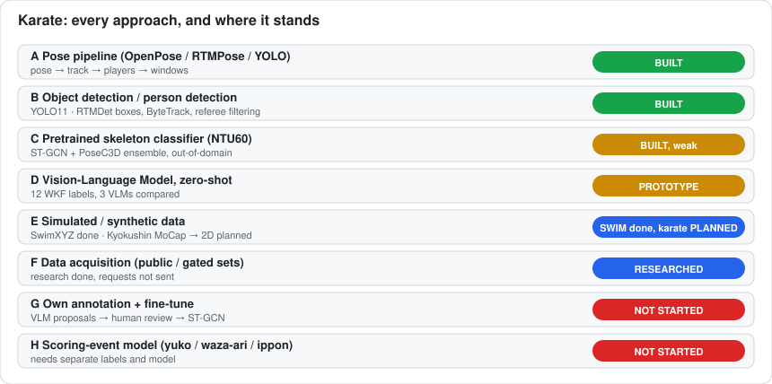
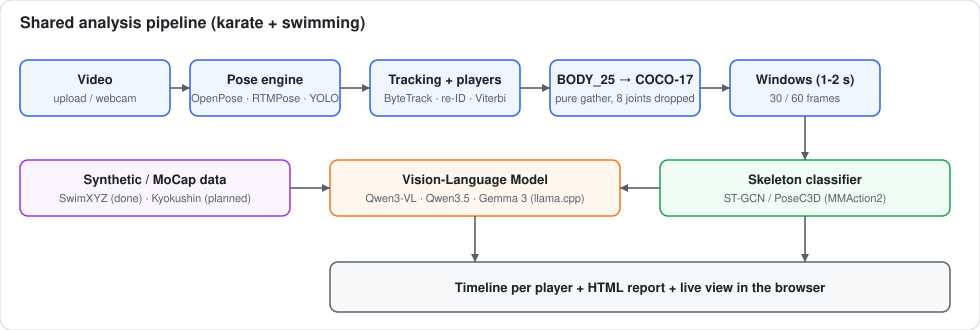
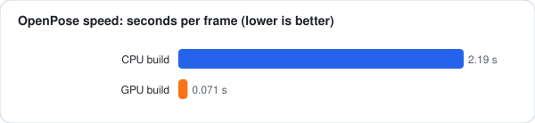
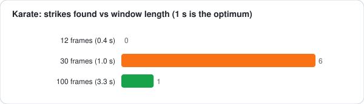
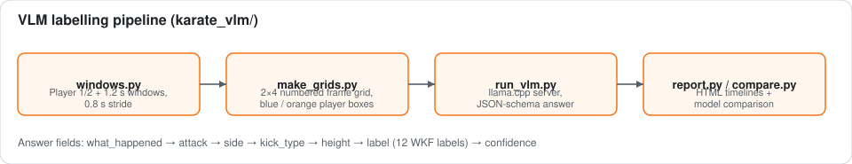
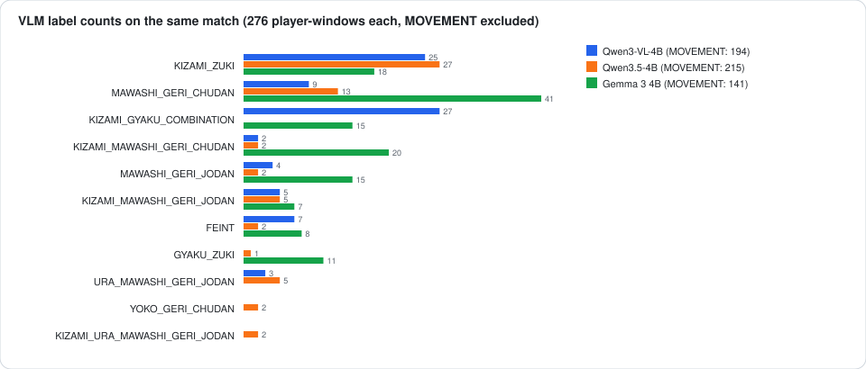

# Karate — every approach, in detail

The hard part of karate is **labels**, not infrastructure. Every approach below is either a way to
*see* the fighters (pose / detection / tracking) or a way to *name what they do* (classifier, VLM, synthetic data).

---

## A. Pose-estimation pipeline (BUILT)

`video → pose engine → OpenPose-format JSON → tracking → BODY_25→COCO-17 → windows → classifier`

| Engine | Where | Notes |
|---|---|---|
| **OpenPose BODY_25 (GPU build)** | `services/openpose_service.py` | 0.071 s/frame, no CUDA toolkit needed, 25 joints incl. feet |
| **RTMDet + RTMPose (Halpe26)** | `backend/pose_extract.py`, `pose_engine_service.py` | top-down; 100 % kumite detection, 0.19 s/frame |
| **YOLO11m-pose** | same | 100 % kumite detection, **0.03 s/frame** (fastest) |

All engines write OpenPose-format JSON, so tracking, conversion and classifiers never change.

**Conversion** (`skeleton_converter.py`): the MMAction2 ST-GCN config declares `layout='coco'` (17 nodes) but OpenPose emits 25.
Every COCO joint has an exact BODY_25 counterpart, so it is a pure gather; Neck, MidHip and the 6 foot joints are dropped
(foot joints matter for kick type — a 25-node graph trained from scratch would keep them). Coordinates stay in raw pixels because
`PreNormalize2D` normalises itself.

**Windows**: measured on real kumite footage — **1-second windows are the optimum** (shorter has no temporal context, longer averages the strike away).

## B. Object / person detection and tracking (BUILT)

Kumite has two fighters plus referee, coach, bench team-mates in the same shirt. The pose output has no identity (`person_id` is always -1), so:

1. **Detection**: person boxes from RTMDet / YOLO11 / skeleton extents.
2. **ByteTrack** (`bytetrack.py`): Kalman prediction + two-stage association (low-confidence blurred fighters are recovered instead of dropped).
   Replaced a centroid tracker that produced **21 tracks for 2 fighters** on a 4865-frame clip and swapped identities in clinches.
3. **Players** (`players_identity.py`, `player_follow.py`): the two people whose **hands and feet** move most (not body motion — that picked the coach),
   on screen together; labels fixed at first joint appearance, each player's reference look (OSNet re-ID) never updated, per-player thresholds
   measured on the same video, re-acquisition only if closer to this player than the other.
4. **Clinch swap repair**: two-state Viterbi over the whole clip with a switching cost.
5. **Ranking** (`skeleton_service.track_people`): `confidence × presence × motion` — motion is essential, without it stationary referees outranked athletes.

## C. Pretrained skeleton classifier (BUILT, out-of-domain)

ST-GCN and PoseC3D from MMAction2 trained on **NTU RGB+D 60** (60 everyday actions, no karate). Two models in an ensemble pooled by "lift over uniform baseline".
Both independently agreed on `punching/slapping other person` at t = 22 s of the test match (0.569 / 0.645), ~88 % of windows are `walking towards each other`.
HMDB51 / UCF101 / Kinetics-400 PoseC3D were tested and rejected (`HulaHoop`, `robot dancing`, …). **It cannot name a technique and never claims to.**

## D. Vision-Language Model, zero-shot (PROTOTYPE) — `karate_vlm/`

Bypasses the missing labels: a local multimodal LLM looks at the fighters directly.

- 1.2 s windows every 0.8 s; **8 frames in one 2×4 numbered grid**, cropped around both fighters, Player 1 blue box, Player 2 orange box.
- A long WKF-referee prompt defines lead/rear side, chudan/jodan, and the 12 labels; the model must fill **step-by-step JSON fields**
  (`what_happened → attack → side → kick_type → height → label → confidence`) constrained by a JSON schema, then the label is checked for consistency with the fields.
- Labels: `KIZAMI_ZUKI, GYAKU_ZUKI, KIZAMI_GYAKU_COMBINATION, MAWASHI_GERI_CHUDAN/JODAN, KIZAMI_MAWASHI_GERI_CHUDAN/JODAN, URA_MAWASHI_GERI_JODAN, KIZAMI_URA_MAWASHI_GERI_JODAN, YOKO_GERI_CHUDAN, FEINT, MOVEMENT`.
- Runs on the RTX 3050 4 GB via llama.cpp (Q4_K_M GGUF), one model at a time, 11–13 s per window.
- Compared on the same 138 windows of `match1`: **Qwen3-VL-4B, Qwen3.5-4B, Gemma 3 4B**.

Honest reading: the models disagree strongly (Gemma 3 finds 41 `MAWASHI_GERI_CHUDAN` windows, Qwen3.5 13, Qwen3-VL 9) and there is **no ground truth**,
so no accuracy is claimed. Value today: a **proposal generator** so a human confirms/corrects instead of scrubbing blind (active-learning style, "Strategy F" in the dataset report).
Weak spots: kicks visible in 1–3 of 8 frames, 4B-parameter models, small fighters in 1080p wide shots.

## E. Simulated / synthetic data (DONE for swimming, PLANNED for karate)

Swimming proved the recipe (see `swimming/` and the README): synthetic skeletons + **corruption that mimics detector failure** + leakage-aware split by underlying motion.
For karate the same idea applies to **Kyokushin MoCap** (CC0, 37 athletes, 1,411 recordings, 3,229 strikes of gyaku-zuki / mae-geri / mawashi-geri / ushiro-mawashi-geri):

1. project 3D C3D markers to 2D under many virtual cameras (viewpoint augmentation),
2. map the 39 Plug-In-Gait markers to COCO-17, scores = 1.0,
3. inject OpenPose-like noise (joint dropout, jitter, limb loss, `(0,0,0)` misses),
4. fine-tune ST-GCN, **leave-one-athlete-out over 37 athletes**,
5. then fine-tune on own annotated tournament footage.

Other synthetic routes worth trying: render humanoid avatars (SMPL / Blender / Unity) performing mocap karate; retarget MoCap to video-realistic characters and run the *same* pose engine to get realistic detector noise instead of hand-made noise.

## F. Data acquisition (RESEARCHED) — `DATASET_RESEARCH.md`
No public labelled karate **video** set is downloadable. Usable: Kyokushin MoCap (CC0), Karate Stances 2026 (CC-BY 4.0), Punch_DL (240 boxing punches).
Gated: MS-KARD (23 classes), Karate Technical Action (1,847 clips), Kumite 35K+ (scoring), KUMITRON. The report lists whom to contact and what to ask for (always athlete IDs).

## G. Own annotation + fine-tuning (NOT STARTED)
Annotation UI (`[start,end] → label`), VLM/classifier windows as *candidates*, `PoseDataset` pickle builder, ST-GCN fine-tune from NTU60 (`load_from`),
**split by athlete, match, camera, tournament**, report per-class F1, confusion matrix, number of held-out athletes. Target for the coarse stage: 7 classes × 200–500 clips, ≥ 20 athletes, ≥ 3 events.

## H. Scoring events (NOT STARTED)
`YUKO / WAZA_ARI / IPPON / NO_SCORE / JOGAI`: depends on control, timing, target area and referee judgement, so it needs its own labels and its own model, separate from technique classification.

## Further approaches that are possible but not attempted
- **RGB action models** (SlowFast, VideoMAE, TimeSformer) fine-tuned on cropped fighter tracks — no skeleton noise, needs RGB labels.
- **Skeleton + RGB fusion** (PoseC3D with RGB stream) for kicks where the foot joints are unreliable.
- **Self-supervised pretraining** (MS-G3D / CTR-GCN / contrastive skeleton learning) on the unlabelled match footage already processed.
- **Temporal action detection** over the dense window scores (smoothing + temporal NMS) instead of clip classification.
- **Interaction model**: two-person graph (attacker/defender distance, ma-ai) for scoring and blocks.
- **3D lifting** (MotionBERT / VideoPose3D) so kicks are judged in 3D instead of a single camera view.
- **VLM fine-tuning** (LoRA on Qwen3-VL) using human-confirmed proposals once labels exist, or a bigger VLM for labelling only.
